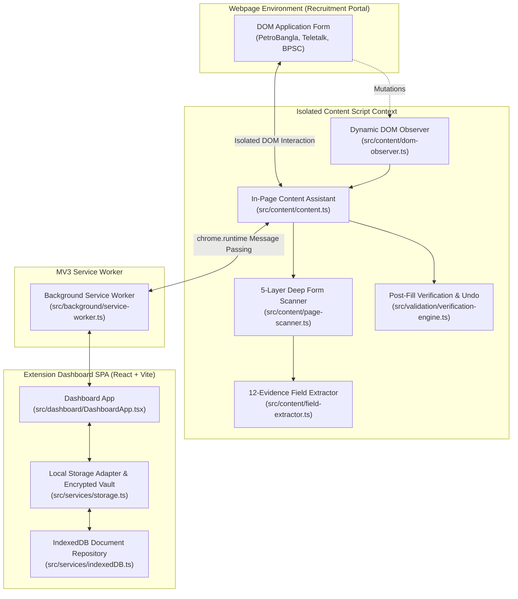
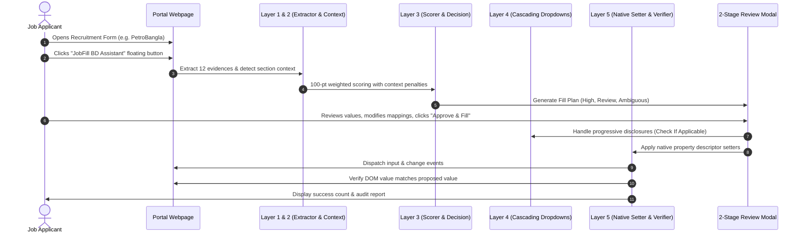

# 🏛️ JobFill BD — System Architecture & Engineering Blueprint
**Document:** `docs/ARCHITECTURE.md`  
**Version:** 2.0.0 (Manifest V3 Production — Google Chrome & Microsoft Edge)  
**Security:** Local-First Encrypted Vault (AES-256-GCM) + Optional Opt-In E2EE Cloud Sync + Zero-PII Public Job Discovery  

---

## 1. High-Level Architectural Overview

JobFill BD is engineered as a secure, privacy-first, 100% client-side Chrome Extension under **Manifest V3**. It consists of three decoupled execution environments connected via strict typed message passing:

---

## 2. Core Security & Privacy Boundaries

1. **Decoupled Key Handling:**  
   The user's master password is never written to disk or transmitted. An AES-256-GCM key is derived on-demand using PBKDF2 with 100,000 iterations and a cryptographically secure random salt; when unset, a non-extractable device `CryptoKey` in IndexedDB encrypts local records.
2. **Controlled Network Boundaries:**  
   No third-party analytics, ads, or remote fonts exist. Background public job circular discovery issues unauthenticated read-only HTTP `GET` requests (`credentials: 'omit'`) with zero user PII. Optional Supabase cloud sync is disabled by default and transmits only client-side AES-256-GCM ciphertext (`profiles_bundle`; uploaded documents stay local-only in v2.0.0).
3. **Least Privilege & Site Isolation:**  
   Google Meet, Zoom, and Google personal productivity/auth hosts are strictly excluded at manifest and runtime levels. Unencrypted `http://` pages trigger explicit sensitivity confirmation before autofilling sensitive fields, and custom origins require explicit per-origin `optional_host_permissions` consent.
4. **Non-Destructive User Control:**  
   JobFill BD never calls `form.submit()`, never clicks elements of type `submit` or payment controls, never bypasses CAPTCHAs or OTPs, and maintains an in-memory Undo stack to revert any fill operation immediately.

---

## 3. The 5-Layer Intelligence Architecture

### Layer Details:
- **Layer 1 — Semantic Intelligence:**  
  Standardizes disparate terminology using a bilingual alias dictionary (`src/intelligence/alias-dictionary.ts`) and value normalizer (`src/intelligence/value-normalizer.ts`), converting Bengali digits (`০-৯`) to English (`0-9`) and standardizing date formats.
- **Layer 2 — Context Intelligence:**  
  Analyzes hierarchical containers (`<fieldset>`, `<legend>`, table headers, card borders) to identify academic levels (`SSC`, `HSC`, `Graduation`, `Masters`) and address types (`Present`, `Permanent`).
- **Layer 3 — Matching Intelligence:**  
  Computes a 100-point weighted score across 12 evidences. Incorporates strict negative penalties (-45 points for academic tier mismatches, -40 points for address mismatches). Identifies ambiguous candidates when the top-candidate margin is under 15 points.
- **Layer 4 — Dynamic Form Intelligence:**  
  Employs `MutationObserver` with bounded timeouts to resolve cascading dropdowns (Division ➔ District ➔ Upazila) and activates hidden sections (`Graduation`, `Masters`, `Job Experience`).
- **Layer 5 — Verification & Execution Intelligence:**  
  Bypasses framework shadow DOM barriers using native prototype setters (`HTMLInputElement.prototype.value`), verifies value retention, checks for pre-existing value conflicts, and logs undo snapshots.

---

## 4. The 8 Advanced Add-on Engines

1. **Cross-Field Consistency Validator (`cross-field-validator.ts`):** Validates logical relationships (e.g., DOB age must be between 18 and 45, passing years must follow `SSC < HSC < Graduation < Masters`, and `mobile === confirmMobile`).
2. **Field Relationship Graph (`relationship-graph.ts`):** Models dependencies and structural parents (`belongs_to`, `depends_on`).
3. **Pre-Fill Form Schema Engine (`form-schema-engine.ts`):** Generates pre-execution blueprints and counts required vs optional inputs.
4. **7-Pass Multi-Pass Scanner (`multi-pass-scanner.ts`):** Multi-stage detection pipeline guaranteeing deep coverage without false positives.
5. **Transactional Form Manager (`transaction-manager.ts`):** Manages atomic transactions with topological dependency sorting.
6. **Website Schema Drift Detector (`schema-change-detector.ts`):** Detects structural drift on recruitment portals and alerts the user.
7. **Site Validation Error Intelligence (`site-error-analyzer.ts`):** Inspects portal error banners and highlights invalid inputs.
8. **Quality Calibration Engine (`quality-calibration.ts`):** Evaluates precision, recall, and accuracy benchmarks across test suites.

---

## 5. Universal Adapter Framework

The extension includes specialized site adapters in `src/adapters/`:
- `PetroBanglaAdapter`: Manages BOGMC, Titas Gas, BGFCL, SGFL, RPGCL, and Bakhrabad Gas forms.
- `TeletalkAdapter`: Manages standard `alljobs.teletalk.com.bd` forms and ministry recruitment portals.
- `BPSCAdapter`: Manages BCS and non-cadre recruitment forms.
- `GenericAdapter`: Fallback adapter using heuristic rules for any unknown Bangladesh government portal.

---

## 6. Official Chrome Developer Standards Alignment

JobFill BD is designed to strictly follow official Google Chrome Extension developer standards across all five core technical pillars:

### A. Manifest V3 Standards (`developer.chrome.com/docs/extensions/develop/`)
- **Event-Driven Service Worker:** Uses a non-persistent background service worker (`background.js`) adhering to short-lived lifecycles and reactive event triggers.
- **Strict Content Security Policy (CSP):** Zero remotely hosted code. No `eval()`, `new Function()`, or CDN `<script>` inclusions. All scripts, icons, and stylesheets are bundled inside the local extension directory.
- **Typed Message Passing:** Secure inter-process communication using `chrome.runtime.onMessage` and `chrome.tabs.sendMessage` with strict request/response action discriminators (`SCAN_PAGE`, `FILL_FORM`, `GET_STATUS`, `VAULT_LOCK`).

### B. Content Scripts & DOM Integration (`developer.chrome.com/docs/extensions/develop/concepts/content-scripts`)
- **Isolated Execution World:** Content scripts execute in Chrome's Isolated World, protecting the extension's code from malicious page scripts while maintaining direct access to standard DOM nodes.
- **Framework-Compatible Synthetic Event Dispatching:**
  To satisfy modern web frameworks (React, Vue, Angular) and legacy jQuery validation on government portals:
  - Values are assigned via native prototype setters: `Object.getOwnPropertyDescriptor(HTMLInputElement.prototype, 'value')!.set.call(elem, val)`.
  - Dispatches full event cascades: `new Event('input', { bubbles: true })`, `new Event('change', { bubbles: true })`, and `new Event('blur', { bubbles: true })`.
- **CSS Isolation:** In-page assistant is rendered inside a dedicated container (`#jobfill-bd-root`) with high z-index and scoped class selectors (`.jobfill-assistant-*`) preventing CSS bleeding into host pages.

### C. Chrome Storage Architecture (`developer.chrome.com/docs/extensions/reference/api/storage`)
- **Hybrid Storage Design:**
  - `chrome.storage.local`: Stores lightweight configuration, UI theme preferences, encrypted master vault headers, and transient circular options.
  - `IndexedDB` (`JobFillBD_SecureStorage` v2): Handles high-volume binary payloads (300×300 applicant photos, 300×80 signatures, certificates) without breaching the `QUOTA_BYTES_PER_ITEM` limits of Chrome Storage.
- **Reactive Storage Events:** Subscribes to `chrome.storage.onChanged` for real-time synchronization between the Dashboard SPA and active browser tabs.

### D. Scripting API (`developer.chrome.com/docs/extensions/reference/api/scripting`)
- Uses declared `scripting` permission for programmatic injection when necessary on active tabs without requiring dangerous broad permissions.

### E. Chrome Web Store User Data Policy (`developer.chrome.com/docs/webstore/program-policies/policies/`)
- **Sensitive Data Minimization:** Handles applicant NID, Date of Birth, mobile numbers, and addresses with military-grade Web Crypto AES-256-GCM encryption at rest.
- **Zero Telemetry / Zero Tracking:** Local-First Profile Vault & Encrypted Storage. Public job circular retrieval requires Internet access via unauthenticated read-only `GET` requests (`credentials: 'omit'`) with zero personal applicant data. Zero analytics SDKs, zero advertising trackers, and zero data brokers (optional Cloud Sync is disabled in the initial Edge Store release).
- **User Control & Deletion:** Complete data portability (JSON export) and irreversible user-initiated data purge (Factory Reset).
