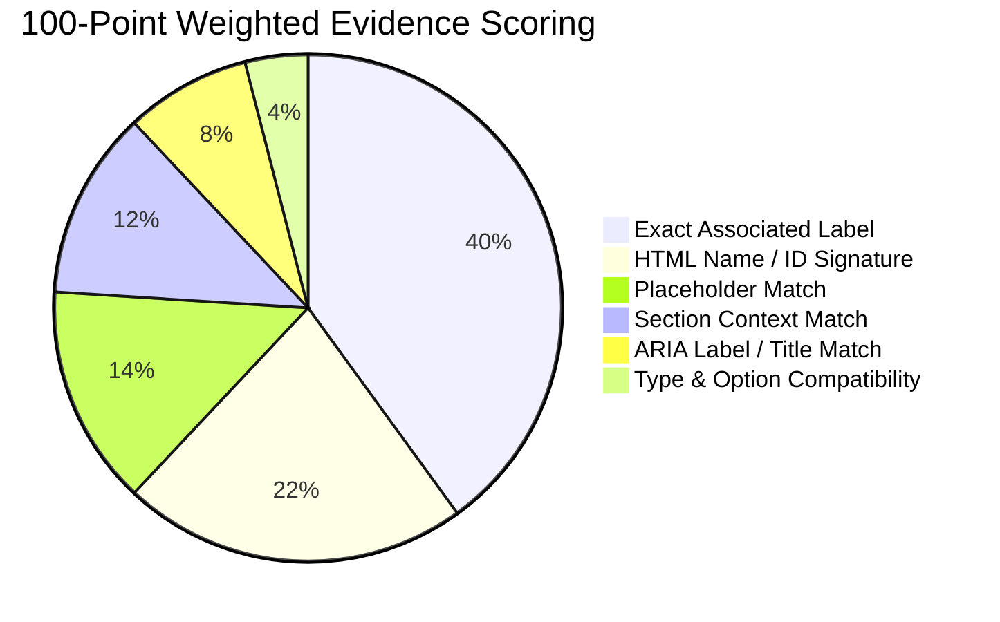
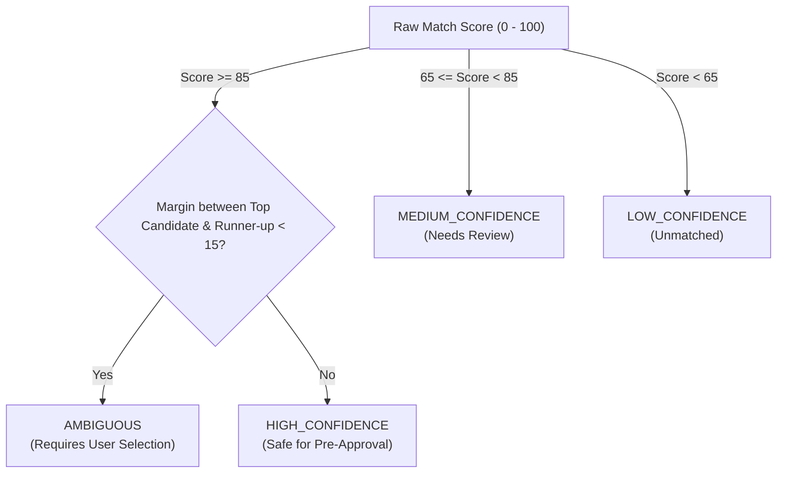

# 🎯 Field Matching & Scoring Engine Specification
**Document:** `docs/FIELD_MATCHING.md`  
**Version:** 2.0.0  
**Algorithm:** 100-Point Weighted Multi-Evidence Scorer with Context Penalties  

---

## 1. 100-Point Weighted Scoring Model

JobFill BD does not rely on fragile CSS selectors or basic regex. Instead, it utilizes a 100-point multi-evidence scoring model:

### Detailed Evidence Weights:
| Evidence Source | Max Points | Evaluation Logic |
|---|---|---|
| **Associated Label** | **+40** | Matches via `<label for="...">`, parent `<label>`, or adjacent `<td>` headers. Exact match = +40; alias dictionary match = +35; partial match = +25. |
| **HTML Name or ID** | **+22** | Inspects `name` and `id` attributes (e.g. `name="app_name"`, `id="txt_mobile"`). Exact match = +22; substring alias match = +18. |
| **Placeholder** | **+14** | Evaluates placeholder text (e.g. `"DD-MM-YYYY"`, `"পিতার নাম (বাংলায়)"`). Full match = +14; partial = +8. |
| **Section Context** | **+12** | Inherited from enclosing `<fieldset><legend>`, section heading pills, or table column headers. Exact academic/address tier match = +12. |
| **ARIA / Title Attributes** | **+8** | Evaluates `aria-label`, `aria-labelledby`, and `title` attributes. |
| **Type & Option Compatibility** | **+4** | Input type matches schema expectation (e.g. `select` for dropdowns, `date` for birth dates). |

---

## 2. Heavy Negative Penalty Engine

To prevent catastrophic false positives (e.g., placing HSC roll into SSC roll, or Father's Name into Applicant Name), the engine applies negative penalties:

| Conflict Condition | Penalty | Impact |
|---|---|---|
| **Academic Level Mismatch** | **-45** | Attempting to match an HSC candidate field inside an SSC section container. |
| **Address Scope Mismatch** | **-45** | Attempting to match a Permanent Address field inside a Present Address container. |
| **Person Identity Conflict** | **-35** | Confusing Applicant, Father, Mother, or Spouse fields. |
| **Data Type Incompatibility** | **-40** | Mapping text string to file input, or binary option to open textarea. |

---

## 3. Decision Tiers & Ambiguity Detection

### Decision Tier Definitions:
1. **HIGH_CONFIDENCE (≥ 85):** Both semantic label and section container agree. Field is pre-checked in the preview modal.
2. **MEDIUM_CONFIDENCE (65 – 84):** Probable match, but some evidence is missing or weak. Displayed with an amber tag for explicit review.
3. **LOW_CONFIDENCE (< 65):** Rejected by default to preserve data integrity.
4. **AMBIGUOUS:** When the score difference between the #1 candidate and #2 candidate is less than 15 points (e.g., bare `"Roll"` or `"Passing Year"` without clear section headings). **Ambiguous fields are NEVER autofilled automatically.**

---

## 4. The 7-Pass Multi-Pass Scanner Pipeline

1. **Pass 1 — Exact Signature Matching:** Queries known portal signatures for exact HTML names/IDs.
2. **Pass 2 — Adaptive Memory Lookup:** Matches learned structural fingerprints from previous confirmed sessions on this domain.
3. **Pass 3 — Context-Aware Semantic Match:** Evaluates bilingual label dictionary combined with section classifiers.
4. **Pass 4 — Dropdown Option Semantic Analysis:** Inspects `<option>` tags inside selects to match enum values.
5. **Pass 5 — Relationship Graph Traversal:** Validates `belongs_to` and `depends_on` relationships.
6. **Pass 6 — Conditional Section Activation:** Detects and triggers toggle checkboxes (e.g., `If Applicable`).
7. **Pass 7 — Unmatched & Conflict Audit:** Flags pre-existing values and unresolved required fields.
