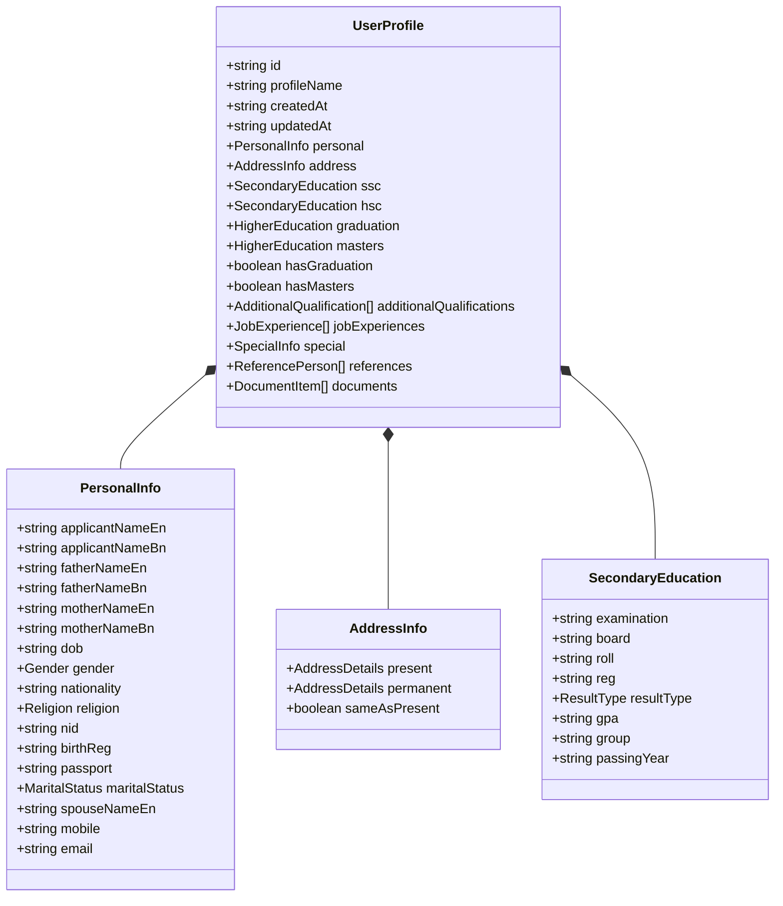

# 🗄️ Canonical Profile Schema Specification
**Document:** `docs/PROFILE_SCHEMA.md`  
**Version:** 2.0.0  
**Specification:** Canonical Semantic Data Dictionary & Dot-Notation Hierarchy  

---

## 1. Schema Design Philosophy

The JobFill BD Canonical Schema enforces strict dot-notation semantic identifiers (`category.subCategory.field.property`). This structure isolates values from display labels, guarantees data consistency, prevents cross-field collisions, and preserves leading zeros in all numeric identifiers.

---

## 2. Comprehensive Field Registry & Canonical IDs

### A. Personal Information (`applicant.*`)
| Canonical Key | Type | Description | Constraints / Validation |
|---|---|---|---|
| `applicant.fullName.english` | `string` | Full name in English | All UPPERCASE as per SSC certificate |
| `applicant.fullName.bangla` | `string` | Full name in Bengali | Bengali Unicode script |
| `applicant.dateOfBirth` | `string` | Date of birth | Format: `YYYY-MM-DD` |
| `applicant.gender` | `enum` | Gender | `'Male'` \| `'Female'` \| `'Other'` |
| `applicant.nationality` | `string` | Nationality | Default: `'Bangladeshi'` |
| `applicant.religion` | `enum` | Religion | `'Islam'` \| `'Hinduism'` \| `'Christianity'` \| `'Buddhism'` \| `'Other'` |
| `applicant.maritalStatus` | `enum` | Marital status | `'Single'` \| `'Married'` \| `'Divorced'` \| `'Widowed'` |
| `applicant.spouseName` | `string` | Spouse's full name | Mandatory if `maritalStatus === 'Married'` |
| `applicant.bloodGroup` | `enum` | Blood group | `'A+'` \| `'A-'` \| `'B+'` \| `'B-'` \| `'AB+'` \| `'AB-'` \| `'O+'` \| `'O-'` |
| `applicant.height` | `string` | Height in centimeters | Numeric string (e.g. `'172.5'`) |
| `applicant.weight` | `string` | Weight in kilograms | Numeric string (e.g. `'68'`) |
| `applicant.chestMeasurement` | `string` | Chest size in centimeters | Numeric string (e.g. `'84'`) |

---

### B. Family Information (`family.*`)
| Canonical Key | Type | Description |
|---|---|---|
| `family.father.name.english` | `string` | Father's name in English UPPERCASE |
| `family.father.name.bangla` | `string` | Father's name in Bengali script |
| `family.mother.name.english` | `string` | Mother's name in English UPPERCASE |
| `family.mother.name.bangla` | `string` | Mother's name in Bengali script |
| `family.spouse.name` | `string` | Spouse's full name |
| `family.guardian.name` | `string` | Legal guardian's name (if parents deceased) |

---

### C. Identity Information (`identity.*`)
| Canonical Key | Type | Description | Constraints |
|---|---|---|---|
| `identity.nationalId` | `string` | Smart / Old National ID | 10, 13, or 17 numeric digits; leading zeros preserved |
| `identity.birthRegistration` | `string` | Digital Birth Registration No | 17 numeric digits; leading zeros preserved |
| `identity.passportNumber` | `string` | Bangladeshi Passport Number | 9 alphanumeric characters |

---

### D. Contact Information (`contact.*`)
| Canonical Key | Type | Description | Constraints |
|---|---|---|---|
| `contact.mobile` | `string` | Primary mobile number | Exactly 11 digits starting with `01` |
| `contact.confirmMobile` | `string` | Mobile number verification | Must strictly equal `contact.mobile` |
| `contact.alternateMobile` | `string` | Secondary mobile number | Optional; 11 digits |
| `contact.email` | `string` | Applicant email address | Valid RFC 5322 format |

---

### E. Address Information (`address.present.*` & `address.permanent.*`)
| Canonical Key | Type | Description |
|---|---|---|
| `address.present.careOf` | `string` | Care of (Father / Guardian / Self) |
| `address.present.village` | `string` | Village / Road / House / Flat |
| `address.present.division` | `string` | Administrative division (e.g. `'Dhaka'`) |
| `address.present.district` | `string` | District name (e.g. `'Dhaka'`) |
| `address.present.upazila` | `string` | Upazila / Police Station name |
| `address.present.postOffice` | `string` | Post office name |
| `address.present.postCode` | `string` | 4-digit postal code (leading zeros preserved) |
| `address.permanent.*` | `*` | Same structure as present address |
| `address.sameAsPresent` | `boolean` | Flag indicating permanent equals present |

---

### F. Education Records (`education.*`)
Supports unlimited academic levels. Each record includes:
- `education.ssc.examination`: `'S.S.C'` | `'Dakhil'` | `'S.S.C Vocational'` | `'Equivalent'`
- `education.ssc.board`: Board of intermediate & secondary education
- `education.ssc.roll`: Examination roll number (leading zeros strictly preserved)
- `education.ssc.reg`: Examination registration number (leading zeros strictly preserved)
- `education.ssc.resultType`: `'GPA (out of 5)'` | `'First Division'` | etc.
- `education.ssc.gpa`: Scale score (e.g. `'5.00'`)
- `education.ssc.group`: `'Science'` | `'Humanities'` | `'Business Studies'`
- `education.ssc.passingYear`: 4-digit year string
- `education.hsc.*`: Higher Secondary Certificate record
- `education.graduation.*`: Bachelor / Honours degree (with `university`, `courseDuration`)
- `education.masters.*`: Masters / Post-graduate degree

---

### G. Job Experience (`experience.*`)
- `experience[i].organization`: Company / Ministry name
- `experience[i].designation`: Post title
- `experience[i].jobType`: `'Government'` | `'Semi-Government'` | `'Autonomous'` | `'Private'`
- `experience[i].startDate`: `YYYY-MM-DD`
- `experience[i].endDate`: `YYYY-MM-DD`
- `experience[i].currentlyWorking`: `boolean`
- `experience[i].description`: Brief job description (max 300 characters enforced)

---

### H. Separation of Circular / Application-Specific Preferences
To guarantee candidate safety, job preferences are never permanently bound to personal identity:
- `circular.postName`: Post applied for
- `circular.examCentre`: Division chosen for preliminary exam
- `circular.quotaDeclaration`: Quota claim for this specific advertisement
- `circular.orgChoice1`: 1st Choice Organization (PetroBangla / BOGMC)
- `circular.orgChoice2`: 2nd Choice Organization (PetroBangla / BOGMC)
